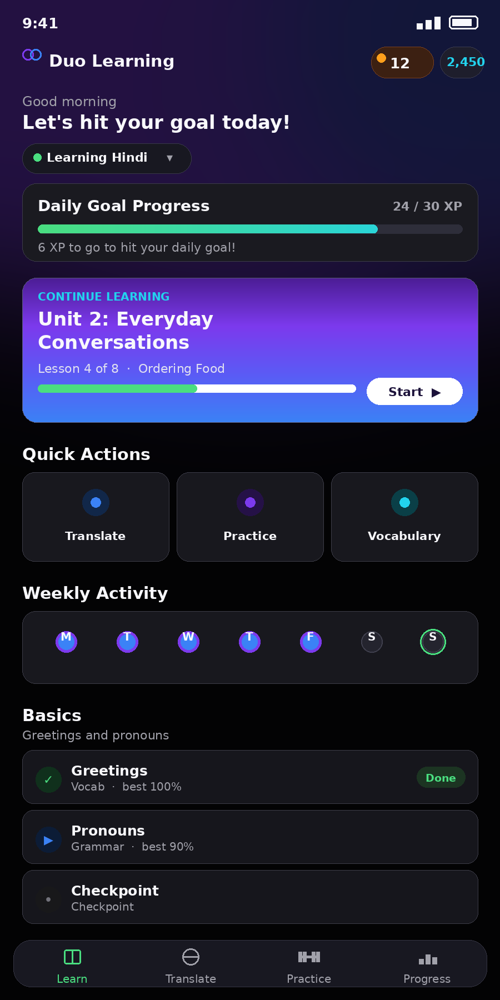
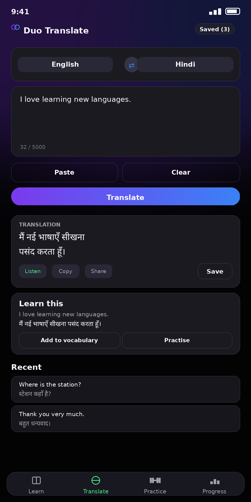
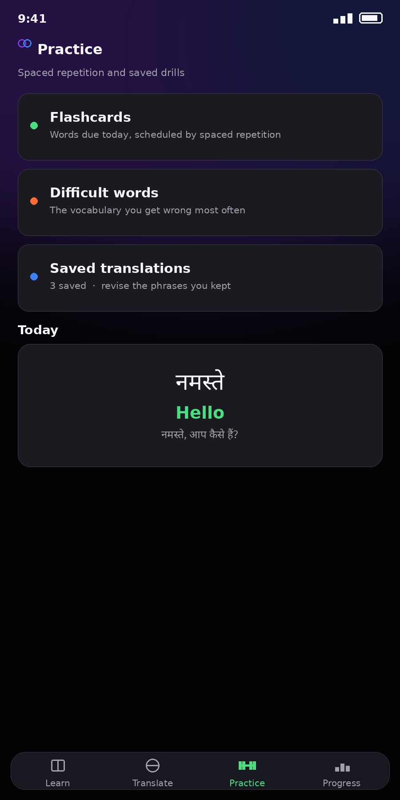
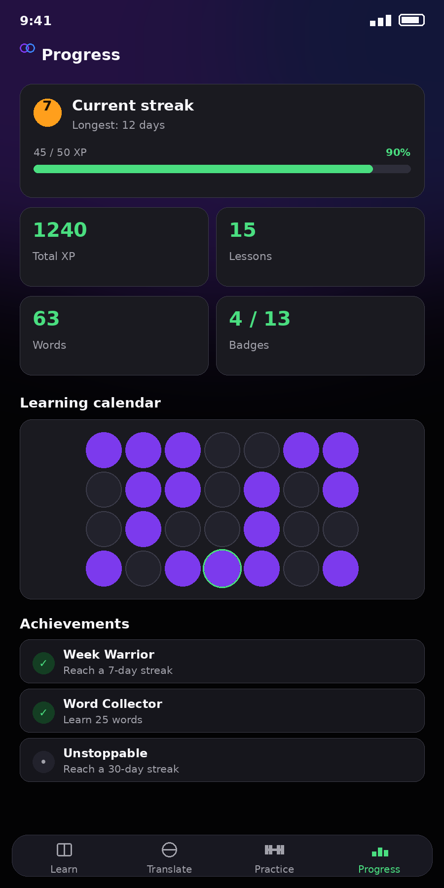

# Duo Learning

## ☕ Donate / Buy me a coffee

**Coming soon** — our donation options are on the way.

| Platform | Status |
| --- | --- |
| Paytm | Coming soon |
| PayPal | Coming soon |
| GPay (Google Pay) | Coming soon |

If you like our work, you can support us with a donation. We are bringing this very soon — **coming soon**.

---

## 🌐 Donate / Buy me a coffee — all languages

**Coming soon** · Paytm · PayPal · GPay — all coming soon.

<details>
<summary><b>🇮🇳 Indian languages</b></summary>

- **Hindi** (हिन्दी): ☕ Donate / Buy me a coffee — जल्द ही आ रहा है। Paytm, PayPal और GPay जल्द ही आ रहे हैं। अगर आपको हमारा काम पसंद है, तो आप डोनेशन देकर हमारा सपोर्ट कर सकते हैं। हम इसे बहुत जल्द ला रहे हैं।
- **Bengali** (বাংলা): ☕ Donate / Buy me a coffee — খুব শিগগিরই আসছে। Paytm, PayPal এবং GPay খুব শিগগিরই আসছে। আমাদের কাজ ভালো লাগলে, আপনি অনুদান দিয়ে আমাদের পাশে দাঁড়াতে পারেন। আমরা খুব তাড়াতাড়ি এটা নিয়ে আসছি।
- **Marathi** (मराठी): ☕ मला कॉफी दान करा / माझ्यासाठी कॉफी विकत घ्या — लवकरच येत आहे. Paytm, PayPal आणि GPay लवकरच येत आहेत. जर तुम्हाला आमचं काम आवडत असेल, तर तुम्ही आम्हाला देणगी देऊन सपोर्ट करू शकता. आम्ही हे लवकरच सुरू करत आहोत.
- **Telugu** (తెలుగు): ☕ నాకు కాఫీ కొనివ్వండి / విరాళం ఇవ్వండి — త్వరలో రాబోతోంది. Paytm, PayPal మరియు GPay త్వరలో రాబోతున్నాయి. మా పని మీకు నచ్చితే, మీరు విరాళం ఇవ్వడం ద్వారా మాకు మద్దతు ఇవ్వవచ్చు. దీన్ని మేము త్వరలోనే తీసుకువస్తున్నాము.
- **Tamil** (தமிழ்): ☕ எனக்கு ஒரு காபி வாங்கிக் கொடுங்கள் / நன்கொடை — விரைவில் வருகிறது. Paytm, PayPal மற்றும் GPay விரைவில் வரவுள்ளன. எங்களுடைய வேலை உங்களுக்குப் பிடித்திருந்தால், நன்கொடை அளித்து நீங்கள் எங்களுக்கு ஆதரவளிக்கலாம். இதை நாங்கள் விரைவில் கொண்டு வருகிறோம்.
- **Gujarati** (ગુજરાતી): ☕ મને કોફી દાન કરો / કોફી ખરીદો — ટૂંક સમયમાં આવી રહ્યું છે. Paytm, PayPal અને GPay ટૂંક સમયમાં આવી રહ્યા છે. જો તમને અમારું કામ ગમે, તો તમે અમને દાન આપીને સપોર્ટ કરી શકો છો. અમે તેને બહુ જલ્દી લાવી રહ્યા છીએ.
- **Kannada** (ಕನ್ನಡ): ☕ ಡೊನೇಟ್ / ನನಗೆ ಒಂದು ಕಾಫಿ ಕೊಡಿಸಿ — ಶೀಘ್ರದಲ್ಲೇ ಬರುತ್ತಿದೆ. Paytm, PayPal ಮತ್ತು GPay ಶೀಘ್ರದಲ್ಲೇ ಬರಲಿವೆ. ನಿಮಗೆ ನಮ್ಮ ಕೆಲಸ ಇಷ್ಟವಾದರೆ, ನೀವು ದೇಣಿಗೆ ನೀಡುವ ಮೂಲಕ ನಮಗೆ ಬೆಂಬಲ ನೀಡಬಹುದು. ನಾವು ಇದನ್ನು ಬಹಳ ಶೀಘ್ರದಲ್ಲೇ ತರುತ್ತಿದ್ದೇವೆ.
- **Malayalam** (മലയാളം): ☕ Donate / Buy me a coffee — ഉടൻ വരുന്നു. Paytm, PayPal, GPay എന്നിവ ഉടൻ വരുന്നു. ഞങ്ങളുടെ വർക്കുകൾ നിങ്ങൾക്ക് ഇഷ്ടമാണെങ്കിൽ, ഒരു സംഭാവന നൽകി ഞങ്ങളെ പിന്തുണയ്ക്കാം. ഞങ്ങൾ ഇത് വളരെ വേഗം കൊണ്ടുവരുന്നുണ്ട്.
- **Odia** (ଓଡ଼ିଆ): ☕ ମୋତେ କଫି କିଣି ଦିଅନ୍ତୁ / ଡୋନେଟ୍ କରନ୍ତୁ — ଖୁବ୍ ଶୀଘ୍ର ଆସୁଛି। Paytm, PayPal ଏବଂ GPay ଖୁବ୍ ଶୀଘ୍ର ଆସୁଛି। ଯଦି ଆପଣଙ୍କୁ ଆମ କାମ ପସନ୍ଦ, ତେବେ ଆପଣ ଆମକୁ ଡୋନେସନ୍ ଦେଇ ସପୋର୍ଟ କରିପାରିବେ। ଆମେ ଏହାକୁ ଖୁବ୍ ଶୀଘ୍ର ଆଣିବୁ।
- **Punjabi** (ਪੰਜਾਬੀ): ☕ ਮੈਨੂੰ ਕੌਫੀ ਦਾਨ ਕਰੋ / ਮੇਰੇ ਲਈ ਕੌਫੀ ਖਰੀਦੋ — ਜਲਦੀ ਆ ਰਿਹਾ ਹੈ। Paytm, PayPal ਅਤੇ GPay ਜਲਦੀ ਆ ਰਹੇ ਹਨ। ਜੇਕਰ ਤੁਹਾਨੂੰ ਸਾਡਾ ਕੰਮ ਪਸੰਦ ਹੈ, ਤਾਂ ਤੁਸੀਂ ਦਾਨ ਦੇ ਕੇ ਸਾਡਾ ਸਾਥ ਦੇ ਸਕਦੇ ਹੋ। ਅਸੀਂ ਇਸਨੂੰ ਬਹੁਤ ਜਲਦੀ ਲੈ ਕੇ ਆ ਰਹੇ ਹਾਂ।
- **Assamese** (অসমীয়া): ☕ Donate / Buy me a coffee — অতি সোনকালেই আহি আছে। Paytm, PayPal আৰু GPay অতি সোনকালেই আহি আছে। যদি আপুনি আমাৰ কাম ভাল পায়, তেন্তে আপুনি দান কৰি আমাক সহায় কৰিব পাৰে। আমি এইটো অতি সোনকালেই লৈ আহি আছোঁ।
- **Urdu** (اردو): ☕ مجھے کافی ڈونیٹ / خریدیں — جلد آرہا ہے۔ Paytm، PayPal اور GPay جلد آرہے ہیں۔ اگر آپ کو ہمارا کام پسند ہے، تو آپ ڈونیشن دے کر ہماری مدد کر سکتے ہیں۔ ہم اسے بہت جلد لا رہے ہیں۔
- **Nepali** (नेपाली): ☕ मलाई कफी किनिदिनुहोस् / दान गर्नुहोस् — छिट्टै आउँदैछ। Paytm, PayPal र GPay पनि छिट्टै आउँदैछन्। यदि तपाईंलाई हाम्रो काम मन पर्छ भने, तपाईंले हामीलाई दान गरेर सहयोग गर्न सक्नुहुन्छ। हामी यो सुविधा धेरै चाँडै ल्याउँदैछौं।
- **Sanskrit** (संस्कृतम्): ☕ मह्यं काफीं क्रीणन्तु / दानं कुर्वन्तु — शीघ्रमेव आगच्छति। Paytm, PayPal तथा GPay अपि शीघ्रमेव आगच्छन्ति। यदि भवन्तः अस्माकं कार्यं रोचन्ते, तर्हि दानं कृत्वा अस्मान् समर्थयितुं शक्नुवन्ति। वयं तत् शीघ्रमेव आनयामः।
- **Konkani** (कोंकणी): ☕ म्हाका कॉफी दान करात / म्हजे खातीर कॉफी घेयात — रोखडेंच येता. Paytm, PayPal आनी GPay रोखडेंच येतले. तुमकां आमचें काम आवडल्यार, तुमी आमकां देणगी दिवन आदार करूंक शकतात. आमी तें खूब बेगीन हाडटात.
- **Maithili** (मैथिली): ☕ हमरा लेल कॉफी डोनेट करू / खरीदू — जल्दिये आबि रहल अछि। Paytm, PayPal आ GPay जल्दिये आबि रहल अछि। जँ अहाँकेँ हमर काज नीक लागैत अछि, तँ अहाँ दान कऽ कऽ हमर समर्थन कऽ सकैत छी। हम एकरा बहुत जल्दी लाबि रहल छी।
- **Kashmiri** (کٲشُر): ☕ مےٚ دِیِو اَکھ کافی — جَلدی یِوان چھُ۔ Paytm, PayPal تہٕ GPay چھِ جَلدی یِوان۔ اَگر تُہؠ سٲنؠ کٲم پَسَند چھِو کَران، تُہؠ ہیٚکِو اَسے اَکھ ڈونیشَن دِتھ سَپورٹ کٔرِتھ۔ اَسؠ چھِ یہِ واریاہ جَلدی اَنان۔
- **Sindhi** (سنڌي): ☕ डोनेट / मूंखे हिक कॉफी वठायो — जल्द अची रह्यो आहे। Paytm, PayPal ऐं GPay जल्द अची रह्या आहिन। जेकडहिं तव्हां खे असां जो कमु वणंदो आहे, त तव्हां असां खे डोनेशन डई सपोर्ट करे सघो था। असीं इहो डाढो जल्द आणी रह्या आहियूं।
- **Dogri** (डोगरी): ☕ डोनेट / मेरे लेई इक कॉफी खरीदो — जल्दी आ करदा ऐ। Paytm, PayPal ते GPay जल्दी आ करदे न। जेकर तुसेंगी साढ़ा कम्म पसंद ऐ, तां तुस साढ़ी मदद दान देइयै करी सकदे ओ। अस इसगी बड़ा जल्दी लेई आ करदे आं।
- **Manipuri** (ꯃꯤꯇꯩ ꯂꯣꯟ): ☕ ꯗꯣꯅꯦꯠ / ꯑꯩꯉꯣꯟꯗꯥ ꯀꯣꯐꯤ ꯑꯃꯥ ꯂꯩꯕꯤꯔꯛꯎ — ꯑꯊꯨꯕꯥ ꯃꯇꯝꯗꯥ ꯂꯥꯛꯀꯅꯤ꯫ Paytm, PayPal ꯑꯃꯁꯨꯡ GPay ꯑꯊꯨꯕꯥ ꯃꯇꯝꯗꯥ ꯂꯥꯛꯀꯅꯤ꯫ ꯀꯔꯤꯒꯨꯝꯕꯥ ꯅꯈꯣꯌꯅꯥ ꯑꯩꯈꯣꯌꯒꯤ ꯊꯕꯛ ꯑꯁꯤ ꯄꯥꯝꯂꯕꯗꯤ, ꯅꯈꯣꯌꯅꯥ ꯗꯣꯅꯦꯁꯟ ꯑꯃꯒꯥ ꯂꯣꯌꯅꯅꯥ ꯑꯩꯈꯣꯌꯕꯨ ꯃꯇꯦꯡ ꯄꯥꯡꯕꯤꯕꯥ ꯌꯥꯏ꯫ ꯑꯩꯈꯣꯌꯅꯥ ꯃꯁꯤ ꯑꯊꯨꯕꯥ ꯃꯇꯝꯗꯥ ꯄꯨꯔꯛꯂꯤ꯫
- **Bodo** (बर’): ☕ आंनो कफि बायना हो — थाबैनो फैगोन। Paytm, PayPal आरो GPay आ थाबैनो फैगोन। जुदि नोंथांमोना जोंनि हाबाखौ मोजां मोनो, नोंथांमोना जोंखौ दान होनानै मदद खालामनो हागोन। जों बेखौ थाबैनो लाबोगोन।
- **Santali** (ᱥᱟᱱᱛᱟᱲᱤ): ☕ ᱫᱟᱱ / ᱤᱧ ᱢᱤᱫ ᱠᱚᱯᱷᱤ ᱠᱤᱨᱤᱧ ᱤᱧ — ᱞᱚᱜᱚᱱ ᱦᱤᱡᱩᱜ ᱠᱟᱱᱟ᱾ Paytm, PayPal ᱟᱨ GPay ᱞᱚᱜᱚᱱ ᱦᱤᱡᱩᱜ ᱠᱟᱱᱟ᱾ ᱡᱩᱫᱤ ᱟᱞᱮᱭᱟᱜ ᱠᱟᱹᱢᱤ ᱯᱮ ᱠᱩᱥᱤᱭᱟᱜ ᱠᱟᱱᱟ, ᱮᱱᱠᱷᱟᱱ ᱫᱟᱱ ᱠᱟᱛᱮ ᱟᱞᱮ ᱜᱚᱲᱚ ᱫᱟᱲᱮᱭᱟᱯᱮᱭᱟ ᱯᱮ᱾ ᱟᱞᱮ ᱱᱚᱶᱟ ᱟᱹᱰᱤ ᱞᱚᱜᱚᱱ ᱞᱮ ᱟᱹᱜᱩᱭᱮᱫᱟ᱾

</details>

<details>
<summary><b>🌍 Global languages</b></summary>

- **Spanish** (Español): ☕ Donar / Invítame un café — Muy pronto. Paytm, PayPal y GPay estarán disponibles muy pronto. Si te gusta nuestro trabajo, puedes apoyarnos con una donación. Lo estamos lanzando muy pronto.
- **French** (Français): ☕ Faire un don / Offrez-moi un café — Bientôt disponible. Paytm, PayPal et GPay arrivent très bientôt. Si vous aimez notre travail, vous pouvez nous soutenir avec un don. Nous le mettons en place très bientôt.
- **German** (Deutsch): ☕ Spenden / Spendier mir einen Kaffee — Bald verfügbar. Paytm, PayPal und GPay kommen sehr bald. Wenn dir unsere Arbeit gefällt, kannst du uns mit einer Spende unterstützen. Wir bringen es sehr bald.
- **Portuguese** (Português): ☕ Doar / Pague-me um café — Em breve. Paytm, PayPal e GPay chegam em breve. Se você gosta do nosso trabalho, pode nos apoiar com uma doação. Estamos trazendo isso muito em breve.
- **Italian** (Italiano): ☕ Dona / Offrimi un caffè — In arrivo. Paytm, PayPal e GPay arrivano presto. Se ti piace il nostro lavoro, puoi sostenerci con una donazione. Lo stiamo lanciando molto presto.
- **Dutch** (Nederlands): ☕ Doneer / Trakteer me op een koffie — Binnenkort beschikbaar. Paytm, PayPal en GPay komen binnenkort. Als je ons werk leuk vindt, kun je ons steunen met een donatie. We brengen dit heel binnenkort.
- **Polish** (Polski): ☕ Przekaż datek / Postaw mi kawę — Wkrótce. Paytm, PayPal i GPay już wkrótce. Jeśli podoba Ci się nasza praca, możesz nas wesprzeć datkiem. Wprowadzamy to bardzo szybko.
- **Russian** (Русский): ☕ Пожертвовать / Купи мне кофе — Скоро. Paytm, PayPal и GPay появятся совсем скоро. Если вам нравится наша работа, вы можете поддержать нас пожертвованием. Мы запускаем это очень скоро.
- **Ukrainian** (Українська): ☕ Пожертвувати / Купи мені каву — Незабаром. Paytm, PayPal і GPay з'являться дуже скоро. Якщо вам подобається наша робота, ви можете підтримати нас пожертвою. Ми запускаємо це дуже скоро.
- **Turkish** (Türkçe): ☕ Bağış yap / Bana bir kahve ısmarla — Çok yakında. Paytm, PayPal ve GPay çok yakında geliyor. İşimizi beğendiyseniz bağışla bizi destekleyebilirsiniz. Çok yakında sunuyoruz.
- **Arabic** (العربية): ☕ تبرّع / اشترِ لي قهوة — قريبًا. Paytm وPayPal وGPay ستتوفر قريبًا جدًا. إذا أعجبك عملنا، يمكنك دعمنا بالتبرع. نطرحه قريبًا جدًا.
- **Persian** (فارسی): ☕ کمک مالی / برایم یک قهوه بخر — به‌زودی. Paytm، PayPal و GPay به‌زودی اضافه می‌شوند. اگر کار ما را دوست دارید، می‌توانید با یک کمک مالی از ما حمایت کنید. این قابلیت را خیلی زود اضافه می‌کنیم.
- **Hebrew** (עברית): ☕ תרומה / קנו לי קפה — בקרוב. Paytm, PayPal ו-GPay יגיעו בקרוב מאוד. אם אתם אוהבים את העבודה שלנו, תוכלו לתמוך בנו בתרומה. אנחנו מביאים את זה בקרוב מאוד.
- **Indonesian** (Bahasa Indonesia): ☕ Donasi / Traktir saya kopi — Segera hadir. Paytm, PayPal, dan GPay segera hadir. Jika Anda menyukai karya kami, Anda dapat mendukung kami dengan donasi. Kami akan menghadirkannya segera.
- **Malay** (Bahasa Melayu): ☕ Derma / Belanja saya kopi — Akan datang. Paytm, PayPal dan GPay akan datang tidak lama lagi. Jika anda suka hasil kerja kami, anda boleh menyokong kami dengan derma. Kami akan membawanya tidak lama lagi.
- **Vietnamese** (Tiếng Việt): ☕ Quyên góp / Mời tôi một ly cà phê — Sắp ra mắt. Paytm, PayPal và GPay sẽ sớm ra mắt. Nếu bạn thích công việc của chúng tôi, bạn có thể ủng hộ bằng một khoản quyên góp. Chúng tôi sẽ sớm mang tính năng này đến.
- **Thai** (ไทย): ☕ บริจาค / เลี้ยงกาแฟฉันสักแก้ว — เร็ว ๆ นี้ Paytm, PayPal และ GPay กำลังจะมาเร็ว ๆ นี้ หากคุณชอบผลงานของเรา คุณสามารถสนับสนุนเราด้วยการบริจาค เรากำลังจะเปิดให้ใช้เร็ว ๆ นี้
- **Japanese** (日本語): ☕ 寄付 / コーヒーをおごる — 近日公開。Paytm、PayPal、GPay も近日対応予定です。私たちの仕事を気に入っていただけたら、寄付で支援できます。まもなく公開します。
- **Korean** (한국어): ☕ 후원 / 커피 한 잔 사주기 — 곧 공개됩니다. Paytm, PayPal, GPay도 곧 지원됩니다. 저희 작업이 마음에 드신다면 후원으로 지원하실 수 있습니다. 곧 선보이겠습니다.
- **Chinese (Simplified)** (简体中文): ☕ 捐赠 / 请我喝杯咖啡 — 即将推出。Paytm、PayPal 和 GPay 即将上线。如果你喜欢我们的作品，可以通过捐赠支持我们。我们很快就会推出。
- **Chinese (Traditional)** (繁體中文): ☕ 捐贈 / 請我喝杯咖啡 — 即將推出。Paytm、PayPal 和 GPay 即將上線。如果你喜歡我們的作品，可以透過捐贈支持我們。我們很快就會推出。
- **Greek** (Ελληνικά): ☕ Δωρεά / Κέρασέ με έναν καφέ — Έρχεται σύντομα. Paytm, PayPal και GPay έρχονται σύντομα. Αν σας αρέσει η δουλειά μας, μπορείτε να μας στηρίξετε με μια δωρεά. Το φέρνουμε πολύ σύντομα.
- **Czech** (Čeština): ☕ Darovat / Kup mi kávu — Již brzy. Paytm, PayPal a GPay budou brzy k dispozici. Pokud se vám naše práce líbí, můžete nás podpořit darem. Přinášíme to velmi brzy.
- **Romanian** (Română): ☕ Donează / Cumpără-mi o cafea — În curând. Paytm, PayPal și GPay vor fi disponibile în curând. Dacă îți place munca noastră, ne poți susține cu o donație. O aducem foarte curând.
- **Hungarian** (Magyar): ☕ Adományozás / Hívj meg egy kávéra — Hamarosan. A Paytm, a PayPal és a GPay hamarosan elérhető. Ha tetszik a munkánk, adománnyal támogathatsz minket. Nagyon hamarosan elhozzuk.
- **Swedish** (Svenska): ☕ Donera / Bjud mig på en kaffe — Kommer snart. Paytm, PayPal och GPay kommer snart. Om du gillar vårt arbete kan du stötta oss med en donation. Vi lanserar det mycket snart.
- **Danish** (Dansk): ☕ Donér / Køb en kaffe til mig — Kommer snart. Paytm, PayPal og GPay kommer snart. Hvis du kan lide vores arbejde, kan du støtte os med en donation. Vi kommer med det meget snart.
- **Norwegian** (Norsk): ☕ Doner / Kjøp en kaffe til meg — Kommer snart. Paytm, PayPal og GPay kommer snart. Hvis du liker arbeidet vårt, kan du støtte oss med en donasjon. Vi lanserer det svært snart.
- **Finnish** (Suomi): ☕ Lahjoita / Tarjoa minulle kahvi — Tulossa pian. Paytm, PayPal ja GPay tulevat pian. Jos pidät työstämme, voit tukea meitä lahjoituksella. Tuomme sen hyvin pian.
- **Swahili** (Kiswahili): ☕ Changia / Ninunulie kahawa — Inakuja hivi karibuni. Paytm, PayPal na GPay zinakuja hivi karibuni. Ikiwa unapenda kazi yetu, unaweza kutusaidia kwa mchango. Tunaileta hivi karibuni.
- **Filipino** (Filipino): ☕ Mag-donate / Bilhan mo ako ng kape — Malapit na. Paparating na ang Paytm, PayPal at GPay. Kung gusto mo ang aming gawa, matutulungan mo kami sa pamamagitan ng donasyon. Ilalabas namin ito sa lalong madaling panahon.

</details>

---

A native Android app that combines a Duolingo-style progressive learning path with a
real, free, on-device universal translator. No account, no ads, no subscriptions, no
analytics, dark by default, and fully usable offline once content and models are on
the device.

- **Platform:** native Android (Kotlin + Jetpack Compose, Material 3)
- **Min SDK:** 24 (Android 7.0) · **Target/Compile SDK:** 34
- **Translation engine:** Google ML Kit on-device translation (free, no API key)
- **Storage:** Room (SQLite) + DataStore, all local
- **Package:** `com.duolearning.app`

> **Important:** this repository contains complete, buildable source. It does **not**
> contain a prebuilt APK, because the build was authored in an environment without a
> JDK/Android SDK. See `docs/BUILD_AND_INSTALL.md` — building takes one Android Studio
> sync. `docs/TEST_REPORT.md` states plainly what was and was not verified.

## Features

**Learn** — Units → lessons → checkpoints with 7 exercise types (multiple choice, typed
translation, word matching, scrambled sentences, fill-in-the-blank, listening, and
translation correction). Answers accept valid alternatives; accents stay significant.
Four real courses ship in the APK (Hindi, English, Spanish, French); every other
language is honestly labelled translation-only.

**Translate** — Source/target pickers, automatic language detection, swap, paste/clear,
copy/share, pronunciation for both sides, recent history, saved favourites, a result
cache keyed on the exact text + pair, and request cancellation when input changes.

**Learn from every translation** — a *Learn this* panel saves a pair to vocabulary and
feeds it into practice. Word-by-word glosses and grammar notes are **not** fabricated
when the engine cannot supply them.

**Practice** — spaced-repetition flashcards (SM-2), a difficult-words drill, and
revision of saved translations.

**Progress** — streak with flame, daily XP goal, learning calendar, achievements,
totals for XP / lessons / words.

**Settings** — daily goal, speech rate, sound, text scale, offline language-pack
management, history controls, and a confirmed full-progress reset.

## Design previews






> These are **design mockups rendered from the app's design tokens**, not screenshots
> from a running build — see `docs/screenshots/README.md`. Replace them with real
> captures after your first build.

## Get a ready-built APK

Push this repo to GitHub and the included workflow builds an installable APK for
you on GitHub's runners — no local Android SDK required. See `docs/CI_BUILD.md`.

## Quick start

1. Open the project folder in Android Studio (Ladybug or newer).
2. Let it sync (it downloads Gradle 8.7 and the Android SDK components).
3. Press **Run**, or build a release APK with:
   ```
   ./gradlew assembleRelease
   ```
   See `docs/BUILD_AND_INSTALL.md` for the wrapper note and signing details.

## Project layout

```
app/src/main/java/com/duolearning/app/
  data/            Room entities/DAOs/database, DataStore prefs, repositories, seed content
  domain/          Pure logic: streaks, XP, spaced repetition, answer validation, achievements
  translate/       TranslationEngine interface + ML Kit implementation + language detection
  audio/           TextToSpeech wrapper
  ui/              Compose theme, navigation, shared components, screens + view models
  di/              Manual dependency container
app/src/test/      JUnit tests for the pure logic and the language-coverage honesty rule
docs/              Coverage, build, engine, test report, limitations, privacy, GitHub notes
```

## Documentation

| Document | Contents |
| --- | --- |
| `docs/LANGUAGE_COVERAGE.md` | Exactly which languages are learnable and translatable, and why |
| `docs/TRANSLATION_ENGINE.md` | ML Kit integration, cost, limits, offline behaviour |
| `docs/BUILD_AND_INSTALL.md` | Build, sign, install, and troubleshooting |
| `docs/ARCHITECTURE.md` | Module-by-module design and data flow |
| `docs/TEST_REPORT.md` | Automated tests + an honest verification status |
| `docs/LIMITATIONS.md` | Known gaps and deliberate scope decisions |
| `docs/PRIVACY.md` | Data handling, in plain language |
| `docs/GITHUB.md` | How to publish this repository yourself |

## Design decisions worth knowing

- **ML Kit over a cloud API.** It is free, needs no key, runs on-device (so offline and
  private), and has a fixed, verifiable language list. The cost is a bounded language
  set and per-language model downloads. This is documented honestly in the UI.
- **Manual dependency injection.** Hilt/Koin would add a build-time processor and size
  for an app this small; the container in `di/AppContainer.kt` is clearer and lighter.
- **No bundled fonts.** The system font family already covers every script the app
  renders, which keeps the APK small.
- **Per-ABI APK splits.** ML Kit's native libraries are the largest size contributor;
  splits keep each download small while a universal APK is still produced.

---

## ⭐ Like this work? Give it a star

If you like this app and our work, please **star this repository** ⭐ and **[follow technicalnihilist-lgtm on GitHub](https://github.com/technicalnihilist-lgtm)**. If our work isn't for you, that's completely fine — the choice is yours. Thank you for stopping by!

<details>
<summary><b>🌍 Same message in 32 languages (A–Z + Indian languages)</b></summary>

- **A — Arabic** (العربية): ⭐ إذا أعجبك هذا التطبيق وعملنا، فيرجى منح المستودع نجمة ومتابعتنا. وإذا لم يعجبك عملنا، فلا مشكلة على الإطلاق — القرار قرارك. شكرًا لزيارتك!
- **B — Bengali** (বাংলা): ⭐ যদি আপনার এই অ্যাপ এবং আমাদের কাজ ভালো লাগে, তবে অনুগ্রহ করে রিপোজিটরিটিকে একটি স্টার দিন এবং আমাদের ফলো করুন। আমাদের কাজ যদি আপনার পছন্দ না হয়, তাতেও কোনো সমস্যা নেই — সিদ্ধান্ত আপনার। আমাদের পেজে আসার জন্য ধন্যবাদ!
- **C — Chinese** (中文): ⭐ 如果你喜欢这个应用和我们的作品，请给仓库点个星标并关注我们。如果我们的作品不适合你，也完全没关系——选择权在你。感谢你的到访！
- **D — Dutch** (Nederlands): ⭐ Vind je deze app en ons werk leuk? Geef de repository dan een ster en volg ons. Vind je ons werk niets, dan is dat helemaal prima — de keuze is aan jou. Bedankt voor je bezoek!
- **E — English** (English): ⭐ If you like this app and our work, please give the repository a star and follow us. If our work isn't for you, that's completely fine — the choice is yours. Thank you for stopping by!
- **F — French** (Français): ⭐ Si cette application et notre travail vous plaisent, mettez une étoile au dépôt et suivez-nous. Si notre travail n'est pas pour vous, aucun souci — c'est votre choix. Merci de votre visite !
- **G — German** (Deutsch): ⭐ Wenn dir diese App und unsere Arbeit gefallen, gib dem Repository einen Stern und folge uns. Wenn unsere Arbeit nichts für dich ist, ist das völlig in Ordnung — die Wahl liegt bei dir. Danke fürs Vorbeischauen!
- **H — Hindi** (हिन्दी): ⭐ अगर आपको यह ऐप और हमारा काम पसंद है, तो कृपया रिपॉजिटरी को स्टार दें और हमें फॉलो करें। अगर हमारा काम आपके लिए नहीं है, तो भी कोई बात नहीं — यह पूरी तरह आपकी मर्ज़ी है। यहाँ आने के लिए आपका धन्यवाद!
- **I — Indonesian** (Bahasa Indonesia): ⭐ Jika kamu suka aplikasi ini dan karya kami, beri bintang pada repositori ini dan ikuti kami. Kalau karya kami bukan untukmu, tidak masalah sama sekali — itu pilihanmu. Terima kasih sudah mampir!
- **J — Japanese** (日本語): ⭐ このアプリと私たちの仕事が気に入ったら、リポジトリにスターを付けてフォローしてください。合わない場合はまったく問題ありません — 選ぶのはあなたです。お越しいただきありがとうございます！
- **K — Korean** (한국어): ⭐ 이 앱과 저희 작업이 마음에 드신다면 저장소에 스타를 눌러 주시고 팔로우해 주세요. 저희 작업이 맞지 않으셔도 전혀 괜찮습니다 — 선택은 여러분의 몫입니다. 방문해 주셔서 감사합니다!
- **L — Lithuanian** (Lietuvių): ⭐ Jei tau patinka ši programa ir mūsų darbas, duok saugyklai žvaigždutę ir sek mus. Jei mūsų darbas ne tau, viskas gerai — pasirinkimas tavo. Ačiū, kad užsukai!
- **M — Malayalam** (മലയാളം): ⭐ നിങ്ങൾക്ക് ഈ ആപ്പും ഞങ്ങളുടെ പ്രവർത്തനവും ഇഷ്ടപ്പെട്ടെങ്കിൽ, ദയവായി റെപ്പോസിറ്ററിക്ക് ഒരു സ്റ്റാർ നൽകുകയും ഞങ്ങളെ ഫോളോ ചെയ്യുകയും ചെയ്യുക. ഞങ്ങളുടെ പ്രവർത്തനം നിങ്ങൾക്ക് അനുയോജ്യമല്ലെങ്കിൽ, അതും തികച്ചും കുഴപ്പമില്ല — തീരുമാനം നിങ്ങളുടേതാണ്. ഇവിടെ വന്നതിന് നന്ദി!
- **N — Nepali** (नेपाली): ⭐ यदि तपाईंलाई यो एप र हाम्रो काम मन पर्‍यो भने, कृपया रिपोजिटरीलाई स्टार दिनुहोस् र हामीलाई फलो गर्नुहोस्। यदि हाम्रो काम तपाईंलाई मन पर्दैन भने, पनि ठीकै छ — यो तपाईंको इच्छा हो। यहाँ आउनुभएकोमा धन्यवाद!
- **O — Odia** (ଓଡ଼ିଆ): ⭐ ଯଦି ଆପଣଙ୍କୁ ଏହି ଆପ୍ ଏବଂ ଆମର କାମ ଭଲ ଲାଗୁଛି, ତେବେ ଦୟାକରି ରିପୋଜିଟୋରୀକୁ ଗୋଟିଏ ଷ୍ଟାର୍ ଦିଅନ୍ତୁ ଏବଂ ଆମକୁ ଫଲୋ କରନ୍ତୁ। ଯଦି ଆମର କାମ ଆପଣଙ୍କ ପାଇଁ ନୁହେଁ, ତେବେ କିଛି ଅସୁବିଧା ନାହିଁ — ପସନ୍ଦ ଆପଣଙ୍କର। ଆମ ପାଖକୁ ଆସିଥିବାରୁ ଧନ୍ୟବାଦ!
- **P — Polish** (Polski): ⭐ Jeśli podoba Ci się ta aplikacja i nasza praca, daj repozytorium gwiazdkę i obserwuj nas. Jeśli nasza praca nie jest dla Ciebie, to zupełnie w porządku — wybór należy do Ciebie. Dziękujemy za odwiedziny!
- **Q — Quechua** (Runa Simi): ⭐ Kay app, ñuqaykup ruwasqanchikpas gustasunki chayqa, repositorioman huk estrella churay, ñuqaykutapas qatipayku. Mana gustasunki chayqa, allinmi — qampa akllayki. Hamusqaykimanta sulpayki!
- **R — Russian** (Русский): ⭐ Если вам нравится это приложение и наша работа, поставьте звёздочку репозиторию и подпишитесь на нас. Если наша работа не для вас — это совершенно нормально, выбор за вами. Спасибо, что заглянули!
- **S — Spanish** (Español): ⭐ Si te gusta esta app y nuestro trabajo, dale una estrella al repositorio y síguenos. Si nuestro trabajo no es para ti, no pasa nada — la decisión es tuya. ¡Gracias por pasarte!
- **T — Tamil** (தமிழ்): ⭐ உங்களுக்கு இந்த ஆப்பும் எங்க வேலையும் பிடிச்சிருந்தா, தயவுசெஞ்சு இந்த ரெபாசிட்டரிக்கு ஒரு ஸ்டார் குடுத்து, எங்களை ஃபாலோ பண்ணுங்க. எங்க வேலை உங்களுக்கு செட் ஆகலைன்னாலும் பரவாயில்லை — அது உங்க விருப்பம். இங்கே வந்ததுக்கு நன்றி!
- **U — Urdu** (اردو): ⭐ اگر آپ کو یہ ایپ اور ہمارا کام پسند آئے تو براہ کرم ریپازٹری کو سٹار دیں اور ہمیں فالو کریں۔ اگر ہمارا کام آپ کے لیے نہیں ہے، تو یہ بالکل ٹھیک ہے — انتخاب آپ کا ہے۔ یہاں تشریف لانے کا شکریہ!
- **V — Vietnamese** (Tiếng Việt): ⭐ Nếu bạn thích ứng dụng này và công việc của chúng tôi, hãy tặng kho lưu trữ một ngôi sao và theo dõi chúng tôi. Nếu công việc của chúng tôi không phù hợp với bạn, điều đó hoàn toàn ổn — lựa chọn là của bạn. Cảm ơn bạn đã ghé qua!
- **W — Welsh** (Cymraeg): ⭐ Os ydych chi'n hoffi'r ap hwn a'n gwaith, rhowch seren i'r storfa a dilynwch ni. Os nad yw ein gwaith ar eich cyfer, mae hynny'n hollol iawn — chi sydd i benderfynu. Diolch am alw heibio!
- **X — Xhosa** (isiXhosa): ⭐ Ukuba uyayithanda le app nomsebenzi wethu, nika irepo inkwenkwezi kwaye usilandele. Ukuba umsebenzi wethu awukufanelanga, akukho ngxaki — lukhetho lwakho. Enkosi ngokutyelela!
- **Y — Yoruba** (Yorùbá): ⭐ Bí app yìí àti iṣẹ́ wa bá wù ọ́, jọ̀wọ́ fún àkójọpọ̀ náà ní ìràwọ̀ kí o sì tẹ̀lé wa. Bí iṣẹ́ wa kò bá yẹ ọ́, kò séwu — ìwọ ni ó yàn. Ẹ ṣé fún wíwá!
- **Z — Zulu** (isiZulu): ⭐ Uma uthanda le app nomsebenzi wethu, nikeza isitoreji inkanyezi bese usilandela. Uma umsebenzi wethu ungakufanele, akunankinga — wukukhetha kwakho. Siyabonga ngokuvakasha!

**More Indian languages**

- **Assamese** (অসমীয়া): ⭐ যদি আপুনি এই এপটো আৰু আমাৰ কাম ভাল পায়, তেন্তে অনুগ্ৰহ কৰি ৰিপজিটৰীটোক এটা ষ্টাৰ দিয়ক আৰু আমাক ফ'ল' কৰক। যদি আমাৰ কাম আপোনাৰ বাবে নহয়, তেন্তে সেয়া একেবাৰে ঠিক আছে — সিদ্ধান্তটো আপোনাৰ। আমাৰ ইয়ালৈ অহাৰ বাবে ধন্যবাদ!
- **Gujarati** (ગુજરાતી): ⭐ જો તમને આ એપ અને અમારું કામ ગમતું હોય, તો પ્લીઝ રિપોઝિટરીને સ્ટાર આપો અને અમને ફોલો કરો. જો અમારું કામ તમને ન ગમતું હોય, તો તે પણ બરાબર છે — પસંદગી તમારી છે. અહીં આવવા બદલ આભાર!
- **Kannada** (ಕನ್ನಡ): ⭐ ನಿಮಗೆ ಈ ಆ್ಯಪ್ ಮತ್ತು ನಮ್ಮ ಕೆಲಸ ಇಷ್ಟವಾದರೆ, ದಯವಿಟ್ಟು ರೆಪೊಸಿಟರಿಗೆ ಸ್ಟಾರ್ ಕೊಡಿ ಮತ್ತು ನಮ್ಮನ್ನು ಫಾಲೋ ಮಾಡಿ. ನಮ್ಮ ಕೆಲಸ ನಿಮಗೆ ಸರಿಹೊಂದದಿದ್ದರೆ, ಅದೂ ಪರವಾಗಿಲ್ಲ — ಆಯ್ಕೆ ನಿಮ್ಮದು. ಭೇಟಿ ನೀಡಿದ್ದಕ್ಕೆ ಧನ್ಯವಾದಗಳು!
- **Marathi** (मराठी): ⭐ जर तुम्हाला हे ॲप आणि आमचं काम आवडलं असेल, तर कृपया रिपॉझिटरीला स्टार द्या आणि आम्हाला फॉलो करा. जर आमचं काम तुम्हाला आवडत नसेल, तर काही हरकत नाही — ती तुमची निवड आहे. इथे आल्याबद्दल धन्यवाद!
- **Punjabi** (ਪੰਜਾਬੀ): ⭐ ਜੇ ਤੁਹਾਨੂੰ ਇਹ ਐਪ ਅਤੇ ਸਾਡਾ ਕੰਮ ਪਸੰਦ ਹੈ, ਤਾਂ ਕਿਰਪਾ ਕਰਕੇ ਰਿਪੋਜ਼ਟਰੀ ਨੂੰ ਸਟਾਰ ਦਿਓ ਅਤੇ ਸਾਨੂੰ ਫਾਲੋ ਕਰੋ। ਜੇ ਸਾਡਾ ਕੰਮ ਤੁਹਾਡੇ ਲਈ ਨਹੀਂ ਹੈ, ਤਾਂ ਕੋਈ ਗੱਲ ਨਹੀਂ — ਚੋਣ ਤੁਹਾਡੀ ਹੈ। ਸਾਡੇ ਪੇਜ 'ਤੇ ਆਉਣ ਲਈ ਧੰਨਵਾਦ!
- **Telugu** (తెలుగు): ⭐ మీకు ఈ యాప్, మా పని నచ్చితే, దయచేసి రిపోజిటరీకి ఒక స్టార్ ఇచ్చి మమ్మల్ని ఫాలో అవ్వండి. ఒకవేళ మా పని మీకు నచ్చకపోతే, పర్వాలేదు — అది మీ ఇష్టం. మమ్మల్ని సందర్శించినందుకు ధన్యవాదాలు!

</details>
